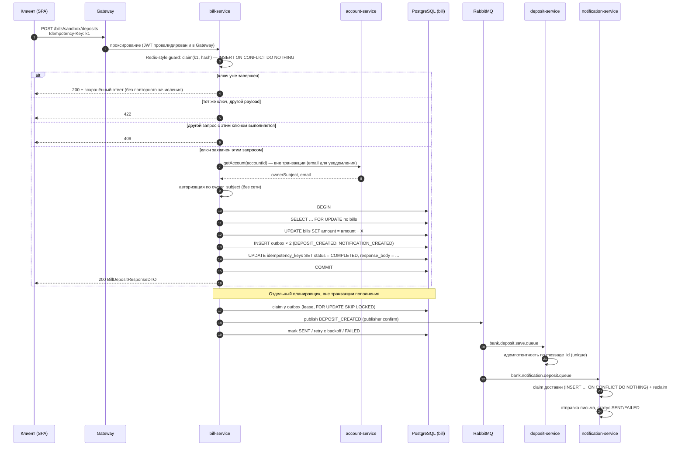

# Сценарий пополнения счёта: последовательность и точки отказа

Денежная операция с точки зрения API — один `POST`. С точки зрения системы —
пять шагов, каждый из которых может отказать отдельно.

## Что происходит при отказе на каждом шаге

| Отказ | Последствия | Как восстанавливается |
|---|---|---|
| Клиент повторил запрос | Второго зачисления нет | `Idempotency-Key`, повтор возвращает сохранённый ответ |
| Падение после `COMMIT`, до ответа клиенту | Баланс изменён, клиент не знает | Повтор с тем же ключом получает тот же ответ |
| Падение внутри транзакции | Ничего не изменено, ключ остался `IN_PROGRESS` | Попытка снимает claim; через 10 минут ключ считается брошенным и переиспользуется |
| RabbitMQ недоступен | Баланс изменён, события ждут в `PENDING` | Relay повторяет с экспоненциальным backoff, лимит 5 минут |
| Relay упал во время публикации | Сообщение может быть доставлено дважды | Lease истекает, сообщение переобрабатывается, consumer идемпотентен |
| Некорректный payload события | Строка переходит в `FAILED` | Не ретраится; логируется ошибка, строка остаётся как доказательство (нужен ручной разбор) |
| deposit-service недоступен | История отстаёт | Очередь durable, сообщение дождётся consumer'а |
| SMTP недоступен | Письмо не отправлено | `FAILED` → reclaim по таймауту, повторная попытка; возможен повтор письма |
| Ответ 5xx от API | Транзакция откатывается | Клиент повторяет с тем же ключом и получает корректный результат |

## Что этот сценарий сознательно не делает

- Нет компенсирующих транзакций: история и письмо — идемпотентные дописывания,
  компенсировать нечего.
- Нет распределённой транзакции: деньги меняются только в одной базе.
- Нет гарантии «ровно один раз» для email: при падении между отправкой и
  записью статуса письмо может уйти повторно. Для банковского уведомления это
  приемлемо и выбрано осознанно (см. ADR 0001).
