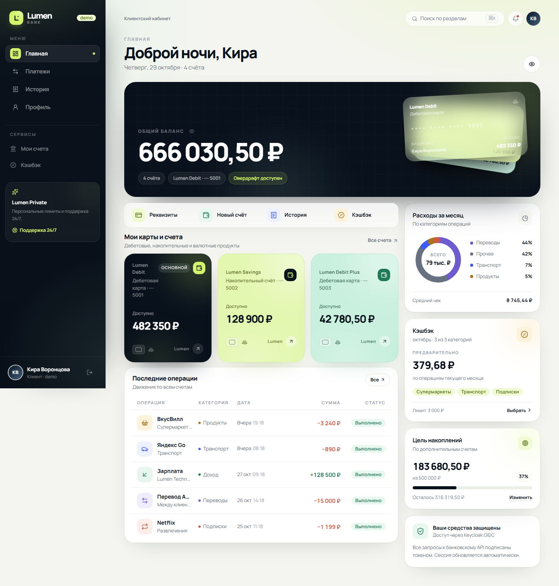
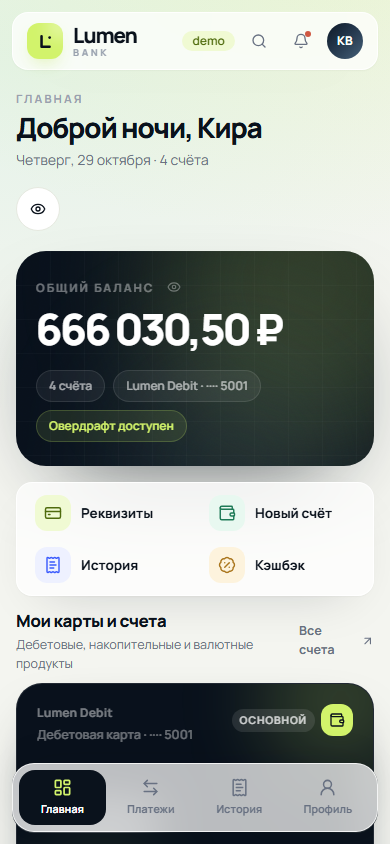
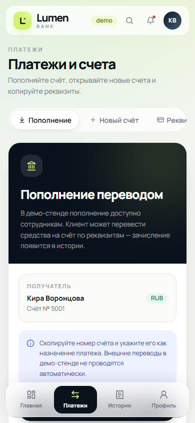
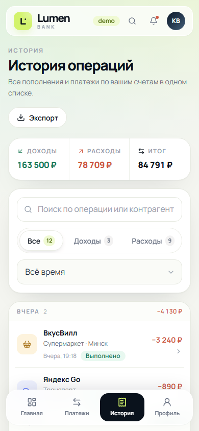
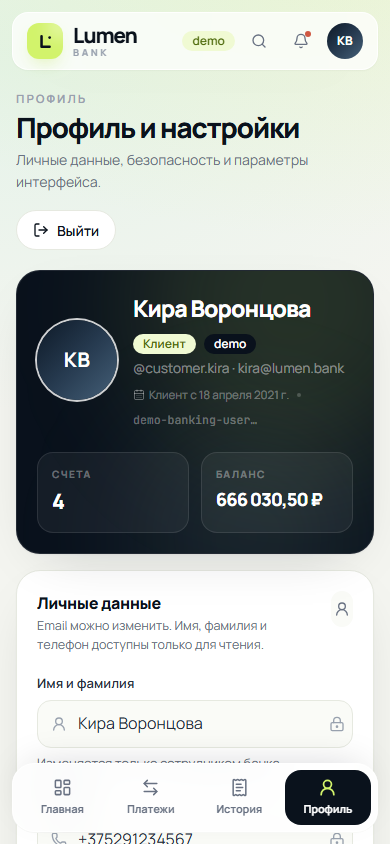
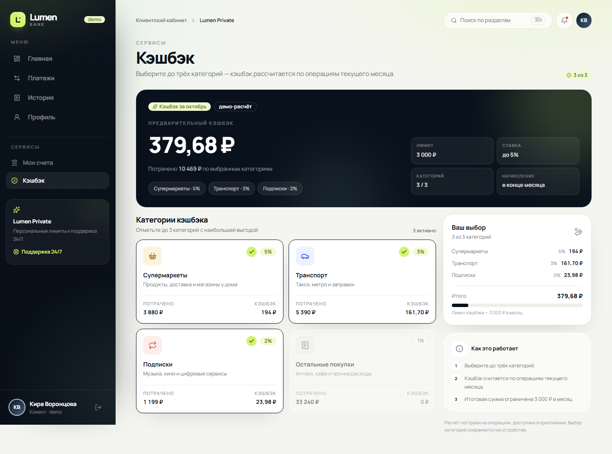
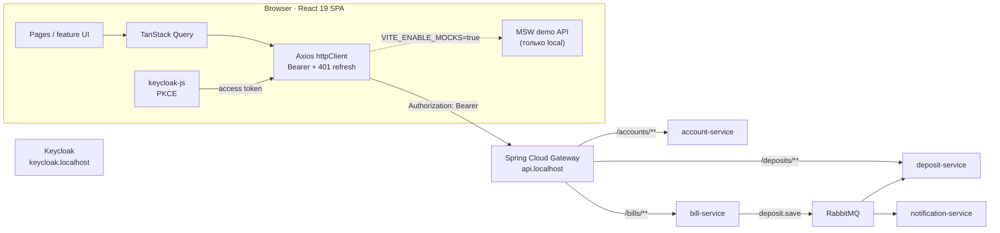
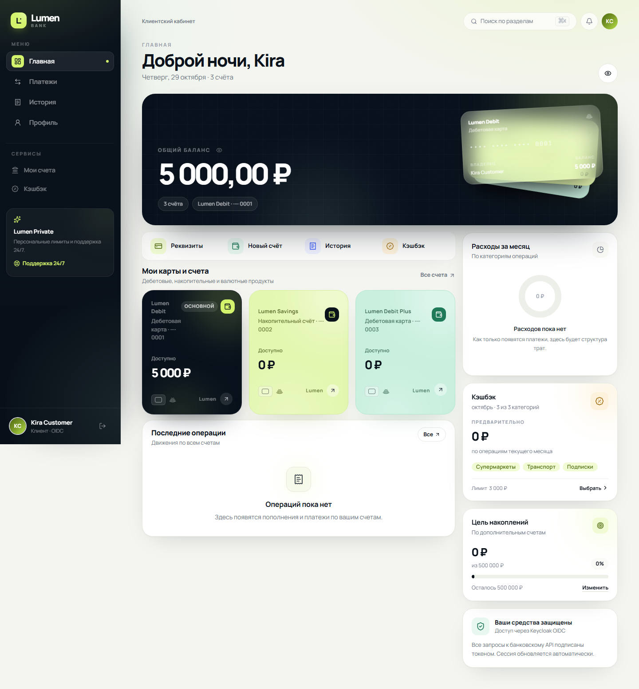

# Lumen Bank — frontend

Production-ready SPA для банковского пет-проекта на **React 19 + TypeScript + Vite**.
Интерфейс работает с реальным Spring Cloud Gateway и Keycloak. В dev-режиме
(`npm run dev`) без запущенного бэкенда автоматически поднимается in-browser API
на MSW — и только в dev: production-сборка отключает его статически
(`import.meta.env.DEV`), поэтому мок-код и `mockServiceWorker.js` в неё не попадают.



## Что внутри

- **Главная** — общий баланс, веер из трёх карт (дебетовая, накопительная и
  Debit Plus), компактная панель действий, последние операции, структура расходов
  и цель накоплений. Кнопка **Открыть карту** запускает мастер выпуска: продукт →
  дизайн (6 готовых коллекций, свой градиент или загруженная картинка за 990 ₽) →
  способ выпуска → проверка → «Заказать на свою почту».
- **Платежи** — sandbox-пополнение для `employee`/`admin`, открытие новых счетов,
  реквизиты и проверка депозита по ID.
- **История** — поиск, фильтры по типу и периоду, группировка по дням, детали
  операции, CSV-выписка.
- **Профиль** — редактирование email, безопасность сессии, переключатели
  интерфейса и демо-переключение ролей. Имя, фамилия и телефон доступны только
  для чтения: их меняет сотрудник банка.
- **Кэшбэк** — выбор до трёх категорий, предварительный расчёт по операциям
  месяца и лимит 3 000 ₽. Выбор хранится на устройстве.
- **Счета** — все счета профиля, детали, копирование реквизитов и открытие
  дополнительных счетов.

### Mobile First

| Главная | Платежи | История | Профиль |
| --- | --- | --- | --- |
|  |  |  |  |

### Кэшбэк

Выбор категорий, расчёт по операциям месяца и лимит 3 000 ₽:



- до `1024px` — полноэкранный контент, стеклянный верхний бар и нижняя навигация
  **Главная · Платежи · История · Профиль**;
- от `1024px` — фиксированный тёмный sidebar, широкий дашборд, таблица операций,
  правая колонка аналитики; нижняя навигация скрывается;
- проверено на ширинах `320`, `390`, `1440` px без горизонтального скролла.

## Стек

| Слой | Решение |
| --- | --- |
| UI | React 19, TypeScript 5.9, Tailwind CSS 4, Lucide React |
| Анимации | Framer Motion — только микро-взаимодействия 200–300 ms |
| Данные | TanStack React Query 5 + Axios |
| Авторизация | Keycloak OIDC (`keycloak-js`, PKCE) |
| Mock API | MSW 3 (Service Worker + localStorage) |
| Роутинг | React Router 7, route-level code splitting |
| Сборка | Vite 8, Nginx в production-контейнере |
| Тесты | Vitest + Testing Library + MSW Node |

## Архитектура



Клиент **не обращается к микросервисам напрямую**: все запросы идут через Gateway,
роли и владение проверяются на бэкенде. MSW перехватывает те же самые URL, поэтому
компоненты и хуки не знают, работают они с Java или с mock-слоем.

Подробные архитектурные решения, матрица ролей и ограничения контракта —
в [docs/architecture.md](docs/architecture.md).

### Структура

```text
src/
├── app/                  # providers, bootstrap, error boundaries
├── auth/                 # Keycloak, demo session, token, signed-out screen
├── api/
│   ├── core/             # axios, interceptors, errors, base config
│   └── modules/          # accounts / bills / deposits clients
├── components/
│   ├── layout/           # AppShell, sidebar, bottom nav, command palette
│   └── ui/               # Button, Input, Modal, Money, Toast, Skeleton, …
├── features/
│   ├── account/          # AccountProvider, mutations, account dialogs
│   ├── activity/         # transaction store, analytics, charts, tables
│   ├── bills/            # product cards, hooks, dialogs
│   ├── cashback/         # offers, local selection store, cashback card
│   ├── preferences/      # privacy / notification preferences
│   └── …
├── lib/                  # money (BigInt), dates, validation, errors
├── mocks/                # MSW handlers + persistent mock DB
├── pages/                # Home, Payments, History, Accounts, Cashback, Profile
└── dto/                  # TypeScript-контракты backend
```

## Интеграция с бэкендом

Базовый URL: `http://api.localhost` · Keycloak: `http://keycloak.localhost`,
realm `bank-realm`, client `banking-frontend`.

| Метод | Endpoint | Где используется | Роли |
| --- | --- | --- | --- |
| `GET` | `/accounts/me` | профиль, главная | любой авторизованный |
| `GET` | `/accounts/{accountId}` | проверка при привязке счёта | владелец, staff |
| `POST` | `/accounts` | onboarding | customer, employee, admin |
| `PUT` | `/accounts/{accountId}` | профиль | владелец, staff |
| `GET` | `/bills/{billId}` | детали счёта | владелец, staff |
| `GET` | `/bills/accounts/{accountId}` | баланс и все счета | владелец, staff |
| `POST` | `/bills` | создание счёта | владелец, staff |
| `POST` | `/bills/accounts/{accountId}` | пакетное открытие счетов | владелец, staff |
| `POST` | `/bills/sandbox/deposits` | sandbox-пополнение | **employee / admin** |
| `GET` | `/deposits/{depositId}` | проверка депозита | **employee / admin** |

Особенности контракта, которые учтены в UI:

- **`GET /accounts/me` не возвращает числовой `accountId`.** Новый профиль
  запоминает ID после `POST /accounts`; на новом устройстве существующий профиль
  можно один раз привязать по номеру счёта (`LinkAccountDialog`). Для demo-режима
  ID `1842` привязывается автоматически.
- **Новый счёт открывается только с балансом `0.00` и без овердрафта** — это
  отражено в форме и подсказках.
- **Sandbox-пополнение требует заголовка `Idempotency-Key`** и доступно только
  `employee`/`admin`. UI генерирует ключ на попытку и переиспользует его при
  повторе той же суммы; изменённая сумма считается новым намерением. Для `customer`
  вкладка показывает сценарий пополнения переводом и реквизиты.
- **Депозиты создаются асинхронно** через RabbitMQ после пополнения, поэтому
  проверка депозита вынесена в отдельный staff-инструмент.

### Авторизация

1. `bootstrapAuth()` инициализирует `keycloak-js` с `onLoad: login-required`,
   `pkceMethod: S256`.
2. Axios-интерсептор добавляет `Authorization: Bearer <token>` к каждому запросу.
3. При `401` выполняется один `updateToken(-1)` и повтор запроса; если сессия
   действительно истекла — показывается модальное окно повторного входа.
4. Роли берутся из `realm_access.roles`; UI адаптируется через `isStaff(user)`.

## Demo-режим и MSW

`.env.development` включает:

```env
VITE_DEMO_MODE=true
VITE_ENABLE_MOCKS=true
```

В этом режиме:

- Keycloak не нужен — создаётся локальная demo-сессия;
- MSW отвечает на реальные пути `/accounts`, `/bills`, `/deposits`;
- данные лежат в `localStorage` (`lumen.mock-db.v1`) и переживают перезагрузку;
- по умолчанию активна роль **customer**;
- роль переключается в **Профиль → Демо-роли**:
  `customer` → `employee` → `admin`.

| Роль | Что видно дополнительно |
| --- | --- |
| `customer` | клиентский кабинет, пополнение переводом, реквизиты |
| `employee` | sandbox-пополнение, проверка депозита |
| `admin` | всё то же + полный набор staff-инструментов |

Демо-данные: счета `5001–5004`, депозиты `9001`, `9002`.
Сброс — удалить в DevTools `lumen.mock-db.v1`, `lumen.activity.v1.*` и
`lumen.preferences.v1`, затем перезагрузить страницу.

## Запуск

```powershell
npm ci
npm run dev
```

- приложение: <http://localhost:5173>
- gateway: `http://api.localhost`
- keycloak: `http://keycloak.localhost`

Для реального OIDC-входа в `hosts` должны резолвиться `keycloak.localhost`,
`api.localhost` и `app.localhost`, а `.env.development` — содержать
`VITE_DEMO_MODE=false` и `VITE_ENABLE_MOCKS=false`.

### Переменные окружения

```env
VITE_KEYCLOAK_URL=http://keycloak.localhost
VITE_KEYCLOAK_REALM=bank-realm
VITE_KEYCLOAK_CLIENT_ID=banking-frontend
VITE_GATEWAY_URL=http://api.localhost

# Выключено для production
VITE_DEMO_MODE=false
VITE_ENABLE_MOCKS=false
```

Любое значение можно переопределить в runtime через `public/config.js`
(`window.__APP_CONFIG__`), не пересобирая контейнер. Поддерживаются оба стиля
ключей: `gatewayUrl` и Helm-style `GATEWAY_URL` (а также `KEYCLOAK_URL`,
`KEYCLOAK_REALM`, `KEYCLOAK_CLIENT_ID`, `DEMO_MODE`, `MOCK_API`).

```js
window.__APP_CONFIG__ = {
  GATEWAY_URL: 'https://api.example.com',
  KEYCLOAK_URL: 'https://sso.example.com',
  KEYCLOAK_REALM: 'bank-realm',
  KEYCLOAK_CLIENT_ID: 'banking-frontend',
}
```

### Демо-пользователи Keycloak

| Логин | Пароль | Роль |
| --- | --- | --- |
| `customer.kira` | `Qpass123` | customer |
| `employee.bob` | `Qpass1234` | employee |
| `admin.kirill` | `Qpass12345` | admin |

## Качество

```powershell
npm run lint        # ESLint 9 + react-hooks + react-refresh
npm run build       # tsc -b + vite build
npm test -- --run   # Vitest: config, auth, MSW handlers, app smoke test
```

Покрыто тестами:

- runtime-конфигурация и base URL;
- конфигурация Keycloak-клиента;
- MSW-контракты: аккаунт, счета, sandbox-пополнение, 403 для customer, депозит;
- smoke-тест приложения: dashboard, данные из API, переходы между разделами.

## Дизайн-система

- **Minimal White + Glassmorphism**: тёплый canvas `#f4f5f0`, стеклянные панели,
  тёмные navy-акценты, lime `#d2f36b` и mint `#b8ecd4`.
- Manrope для текста, JetBrains Mono для чисел и идентификаторов.
- Все денежные суммы считаются через `BigInt` в минорных единицах — без
  floating point drift.
- Skeleton-состояния для главной, счетов, платежей и профиля.
- Пустые состояния и error boundaries на уровне приложения и страницы.
- `prefers-reduced-motion` отключает анимации.
- Глобальный переключатель «Скрывать балансы» маскирует суммы во всех компонентах,
  включая график расходов.

## Production

```powershell
npm run build
docker build -t lumen-frontend .
```

Nginx раздаёт SPA с fallback на `index.html`, кэширует хэшированные assets и
запрещает кэширование `config.js`. Runtime-конфиг подаётся через
`/config.js` и Helm/ConfigMap, поэтому один образ подходит для разных окружений.

## Полный стек

Поддерживаемый end-to-end запуск — Docker Desktop + kind + Helm. Инструкция,
проверенный сценарий и текущие ограничения (включая отсутствие P2P-переводов)
находятся в [deploy/README.md](../deploy/README.md).

Проверенный сценарий на реальном стеке: вход `customer.kira` через Keycloak,
создание 3 счетов, sandbox-пополнение на 5 000 ₽ и отображение карт на дашборде.



## Coverage policy

`npm run test:coverage` reports the whole SPA with the v8 provider and writes
`coverage/lcov.info`, which Sonar reads through `sonar-project.properties`.

- **Included:** everything under `src/`.
- **Excluded (and why):** `src/main.tsx` (entry point that only mounts React),
  `src/test/**` (test harness), `**/*.d.ts` and `src/vite-env.d.ts` (type-only).
- **Global floors (ratchet, only go up):** lines 40, statements 40, functions 35,
  branches 30. They currently sit just under the measured values
  (lines 44.4, statements 43.1).
- **Per-module floors:** `src/lib/money.ts` and `src/lib/validation.ts` at
  85 lines/statements/functions and 80 branches, because they hold the money and
  input rules where a regression costs real correctness.
- **Ratchet:** when a change lifts a metric, raise the floor in the same PR. Never
  lower a floor without a written reason in the PR description.
- **Sonar:** the analysis in CI passes these arguments through `-Dsonar.*` in
  `.github/workflows/ci.yml`; `sonar-project.properties` holds the same values for
  local runs of `sonar-scanner`. Keep the two in sync.

### Metric of record

`node ../scripts/coverage/new-code.mjs` (run from `frontend/` or with `--lcov`)
reproduces Sonar's "coverage on new code" for the files touched by the branch:
`(LH + BRH) / (LF + BRF)` over `git diff origin/main...HEAD`, excluding tests,
`src/main.tsx`, `src/test/**` and `*.d.ts`. Every number in a coverage PR
description must come from this script.

- Sonar parameters have a single source: `sonar-project.properties`. CI passes
  only `sonar.organization` and `sonar.qualitygate.wait=true`.
- Verified with Vitest 5.0.5 (`npx vitest --version`).
- `src/mocks/**` is dev-only: the dynamic import is guarded by
  `import.meta.env.DEV`, so a production build folds the branch away and no
  `browser-*.js` (MSW) chunk is emitted at all.
