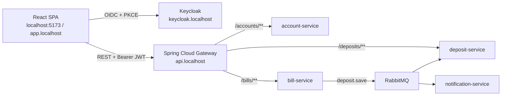

# Architecture notes

These notes are the persistent reference for the frontend. They describe the
decisions that are easy to forget when returning to the project.

## Runtime topology



The SPA never talks to service ports directly. This keeps the security boundary
in Gateway + Keycloak and makes the local `api.localhost` / production host split
transparent to the code.

## Decisions

| Decision | Why |
| --- | --- |
| Minimal White + glass cards + navy/lime accents | A calm private-banking feel; glass gives depth without heavy gradients. Dark navy is reserved for balance and staff areas. |
| BigInt minor units for all money arithmetic | Prevents floating-point drift in totals, charts and receipts. `lib/money.ts` is the only place that converts. |
| Numeric `accountId` is stored per subject in `localStorage` | `GET /accounts/me` does not return the id. New profiles link automatically; existing profiles on a new device use `LinkAccountDialog` and verify `ownerSubject`. |
| Role gating in both UI and API | The UI hides sandbox actions for customers; the Java services still enforce `employee`/`admin` with `@PreAuthorize`. Never rely on UI-only authorization. |
| Legal name and phone are read-only | The profile form only edits email; name and phone are rendered read-only and the PUT payload reuses the server values, so they cannot be changed from the client. |
| MSW resolves routes against the runtime gateway origin | Handlers build absolute URLs from `appConfig.gatewayUrl`, so `/bills/accounts/:id` cannot accidentally match `/accounts/:id` and a runtime gateway override still works. |
| Query cache is the server-state layer | Components never copy API data into global state. Mutations invalidate `account`, `bills` and `bills/account/:id` keys. |
| Local activity store for receipts and history | The backend has no "list deposits" endpoint. The UI records operations it performs and seeds demo history only in demo mode. The UI states this explicitly. |
| Card products are mapped from the bill order | The backend exposes bills without a product type. The default bill is presented as `Lumen Debit`; the next slots are `Lumen Savings`, `Lumen Debit Plus` and `Lumen Travel`. The mapping lives in `bill-format.ts` and is easy to replace with API metadata. |
| Cashback selection is a local promo layer | There is no cashback endpoint. Categories and the estimate are computed from local activities, capped at 3 000 ₽, and stored in `lumen.cashback.v1`. The UI labels the figure as a preliminary/demo estimate. |
| Runtime config accepts both camelCase and Helm-style uppercase keys | The existing `frontendConfig` ConfigMap uses `GATEWAY_URL`/`KEYCLOAK_URL`; the SPA normalises those keys without a rebuild. |
| Lazy routes | Each page is a separate chunk; the shell, auth and UI kit stay in the initial bundle. |
| Page-level and app-level error boundaries | A broken page keeps navigation/session available; a root failure still has a safe reload screen. |
| Reduced motion respected globally | All Framer Motion interactions are short and disabled by `prefers-reduced-motion`. |

## Folder contract

```text
pages/*            route composition only
features/*         domain hooks, stores, feature components
components/ui/*    stateless design-system primitives
components/layout  shell and navigation
api/*              transport and DTO mapping
auth/*             OIDC, demo session, token lifecycle
mocks/*            MSW handlers + persistent demo database
features/cashback/* offers, local selection store, cashback card
lib/*              money, date, validation, error mapping
dto/*              backend request/response contracts
```

Rules:

- no `any` in feature/page code;
- transports return DTOs, pages map them to view models;
- every mutation has a toast or an inline error state;
- loading states use skeletons, not spinners, except button-level mutations;
- all destructive/irreversible actions are kept out of the demo.

## Role matrix

| Capability | customer | employee | admin |
| --- | :---: | :---: | :---: |
| View own balance / bills / card products | ✓ | ✓ | ✓ |
| Open a bill | ✓ | ✓ | ✓ |
| Edit profile (email only) | ✓ | ✓ | ✓ |
| Choose cashback categories | ✓ | ✓ | ✓ |
| Sandbox deposit | — | ✓ | ✓ |
| Deposit lookup | — | ✓ | ✓ |

## Known limitations

- History is device-local because the backend exposes deposits only by id.
- Account id linking is a client-side workaround for the current `AccountResponseDTO`.
- Cashback categories and the estimate are a local promo layer; there is no server-side cashback engine yet.
- CSV export contains the currently filtered rows; it is intentionally not server-side.
- MSW is disabled in production builds; no demo data ships in the runtime path.
